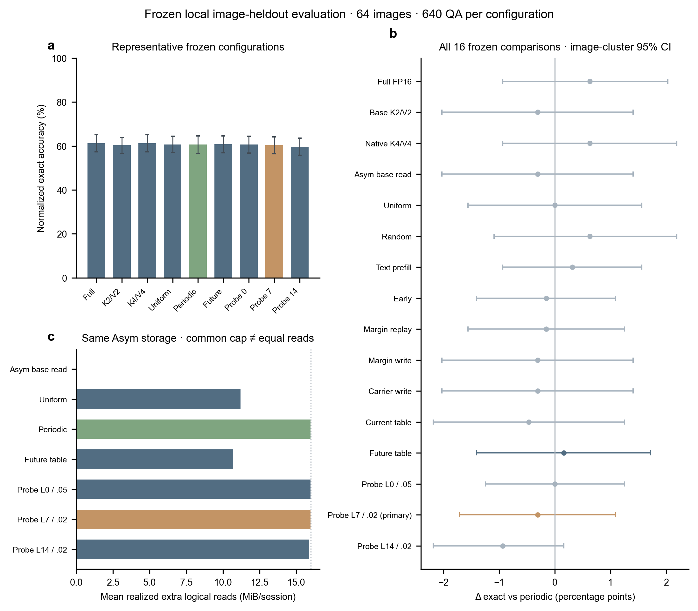
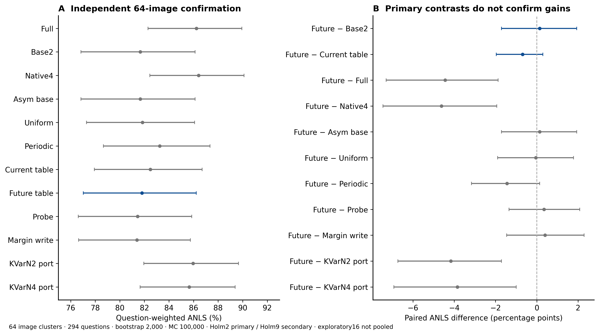

# TrajKV 两周研究工作包：完整收尾报告

生成时间：2026-11-12T23:39:44.071916+08:00。这是本次授权的研究周期收尾，不表示经历十四个自然日，也不表示论文已达到投稿水平。

**结论：执行器、数据与原型已经做成，当前“H-K载体 + Margin/双读探针”的具体方法主张没有获得稳定优势。** 我们完成了真实GPU实现、分支标定、两轮隔离验证、外部数据、强量化算子参照和控制计时。探索16文档中出现的收益，随后用64张新文档确认后未复现。建议保留本轮代码和测量能力，重新设计论文的核心收益机制。

## 1. 实际完成了什么

推理使用用户的双 RTX 3090 24GB，InternVL3-8B-hf，实际dtype为FP16；本地CPU用于整理、统计与绘图。模型4个完整safetensors分片及配置/tokenizer共11文件做了完整SHA256，分片合计15,888,846,496字节。运行时版本见[runtime identity](../audit/runtime_identity.json)。全部生成在本地授权GPU上运行，无付费模型API调用。

| 工作 | 实际规模与角色 |
|---|---|
| 开发与原型迭代 | 16张CLEVR开发图；同一8图用于离线表/无升级探针标定，另8图作开发检验 |
| 冻结主评测 | 64图×10轮；17配置=10,880回答；补KVarN2/4同图质量参照后共19配置、12,160回答 |
| 预算阈值后续验证 | 另32图×10轮×12配置=3,840回答；没有重新使用主64图拟合 |
| 四档预算 | 同32图中预先固定的16图，4/8/16/32 MiB×4策略=2,560回答；不增加独立图像数 |
| DocVQA探索 | 16文档、64问、8配置；只作探索 |
| DocVQA确认 | 排除开发/探索图后哈希固定64文档，最多6轮，共294问×12配置=3,528回答 |
| 其它外部测试 | GQA16图/128问；ConvBench4会话/12问；描述后追问桥接4图，描述轮不评分 |
| 机制诊断 | 同token四臂8会话；K/V单位置/词span手术两轮各4会话；五档连续剂量；原始反例保留 |
| 控制计时 | 同一4会话/固定token，每配置1次warmup+3测量；108次测量、36份allocator审计 |

实际使用的唯一图像并集为212，包含开发和验证；方法数、剂量数、重复次数及预算cohort没有当成独立样本。详细结构盘点见[run inventory](../audit/run_inventory.json)。

## 2. 主64图：新策略没有超越简单对照

主统计单位为64张图，每配置640题。所有渐进策略采用相同常驻表示与16 MiB额外**逻辑**读取额度；实际消耗分别报告。

| 配置 | 指标 (%) |
|---|---:|
| Full FP16（同执行器） | 61.250 |
| K2/V2视觉算子 | 60.312 |
| 独立K4/V4 | 61.250 |
| 周期精化 | 60.625 |
| 未来收益表 | 60.781 |
| 预设Probe L7 / 0.02 | 60.312 |

预设Probe7相对周期为 **−0.3125pp，图像配对95%CI [−1.7188,+1.0938]，Holm16 p=1**，修复7题、新增错9题。未来收益表相对周期为+0.1563pp，CI跨零。全部16个比较未建立优势；这不构成方法等价性证明。

KVarN2†为388/640、KVarN4†为389/640。†使用锁定的官方底层数值函数，通过统一骨干/执行器评质量；当前同时保留packed reference与物化decoded tensor，不能当成官方vLLM复现或packed效率胜利。

[主17完整报告](../results/analysis_eval64_main_v1/formal_report.md) · [19配置与KVarN参照](../results/analysis_eval64_with_kvarn_v1/quality19_report.md)

## 3. 原型如何迭代，以及迭代后怎样

最初将前驱重算与载体状态写入拆成了两个实际策略；随后实现了当前q下的base/residual双读，触发当前步后续层精化。三个探针位置为0/7/14层。实际探针成本包含第二次base/text读取、残差和后续精化，controller局部两读量未重复加到全局账。

开发中低阈值几乎全触发，因此又运行48条无升级标定轨迹，逐条验证与对应基础轨迹的token/位置完全相同。新的阈值只用当前偏移和成本标定，未使用答案、未来query或FP16参考logits；在线仍有硬额度。

在独立32图上，新L7阈值为0.17655292031960651。旧阈值的384次已观测探针全部请求升级；新阈值decode仅68/663、prefill为0/283。实际extra由15.9649降到14.3393 MiB，选择性得到了恢复。

但新阈值203/320，周期205/320；Δ **−0.625pp，CI [−2.1875,+0.9375]，Holm11 p=1**。相对旧探针多对1题，CI仍跨零。预算标定改善了使用方式，尚未建立任务质量优势。

四档预算没有显示稳定大幅质量提升；其16图与上述32图嵌套，不合成48图。该曲线使用原先固定的四策略，不能写成四档新阈值效果。

[rep32报告](../results/analysis_replication32_v1/replication_report.md) · [四预算报告](../results/analysis_budget_sweep_rep16_v1/sweep_report.md)

## 4. DocVQA：探索信号经确认后消退

探索16图中，未来表对基础2-bit ANLS为+2.43pp，来自4个软分改善，其中只有2题变成精确正确。于是固定方法和全部控制，从剩余文档哈希选出64张新图确认；这是看到探索汇总后的前瞻确认批次，未伪称更早预注册，也没有合并80图充作全盲测试。

64文档确认结果（组织者代码口径ANLS）：

| 配置 | 指标 (%) |
|---|---:|
| Full FP16 | 86.240 |
| K2/V2 | 81.662 |
| 独立K4/V4 | 86.416 |
| 渐进存储仅基础读取 | 81.662 |
| 均匀精化 | 81.846 |
| 周期精化 | 83.244 |
| 当前收益表 | 82.485 |
| 未来收益表 | 81.799 |
| Probe L7 / 0.02 | 81.446 |
| Margin写入 | 81.395 |
| KVarN2† | 85.959 |
| KVarN4† | 85.650 |

未来表对Base2仅 **+0.1367pp，95%CI [−1.7148,+1.9337]，主Holm2 p=0.88334**；对当前表 **−0.6868pp，CI [−1.9670,+0.2958]，主Holm2 p=0.64747**。两个主比较均未确认。

Future相对Base2有11题软分提高、6题下降，但exact仅4题追回、3题新增错；不能把11个软分变化称为11题答对。KVarN2质量参照85.96已接近Full86.24，显示较强的表示量化能解释很多差距。其物化移植运行不支持部署显存/速度比较。

[确认报告与全部比较](DOCVQA_CONFIRM64_REPORT.zh.md) · [原探索16及GQA/ConvBench报告](EXTERNAL_VALIDATION_REPORT.zh.md)

## 5. 对外部补充建议的实测判断

- **历史数值状态路径存在。** 相同token/位置下，8会话四臂history-only KL均值0.002288，direct-read为0.030074；N1/N2空白最大logit差均0。KL与交互不能直接分解成任务损失百分比，且存在恢复后反向的案例。
- **H-K尚无普遍支持。** 最初2-bit单位置干预600个未来响应无argmax翻转；随机控制大多为零扰动，已在第二轮按幅度匹配修正。真实1-bit背景下载体和幅度匹配随机位置的K/V差区间均跨零。visual-K残差效果不能替代text-K载体机制证明。
- **Margin没有成为未来损害预测器。** 开发Base2的一般错误AUROC为0.759，但该开发子集没有相对Full的负翻转；不能据此声称测到了压缩特有损害。低阈值还会漏掉高置信错误。
- **中层双读可运行，收益代理仍不充分。** 当前纠偏幅度可在线计算，也能按额度标定；两轮隔离评测尚未展示胜过简单控制的质量优势。
- **局部刷新需要真实计算。** 参考切片手术是诊断。实际最近一轮重算按原suffix/逐token路径执行；初版漏估多次replay的16条开发记录已保留并排除同额度结论，后续按真实调用计费。不能把少量KV覆盖成本等同于产生准确KV的成本。
- **资源轴本身不是独立新颖性。** [ReadKV](https://arxiv.org/html/2610.11245v1)已有渐进存储与query级读取预算；[KVarN](https://arxiv.org/html/2606.03458v1)已有状态误差积累研究；[TriAxialKV](https://arxiv.org/html/2605.17170v1)已有多轮多模态敏感度分配。新论文需要额外可验证能力。

详细机制/反例见[机制报告](EXPLORATION_MECHANISMS_DEV_V1.md)、[Margin与Fidelity](EXPLORATION_MARGIN_AND_FIDELITY_DEV8.md)、[Probe与幅度匹配](EXPLORATION_PROBE_AND_NORMMATCH_DEV.md)。

## 6. 真实成本和数据边界

四会话、三重复总时间中位数：Full5.254s、Periodic5.818s、Probe5.873s；Probe比Periodic慢约0.95%，没有提速证据。常驻cache owner从45.211降到34.656 MiB，allocator增量从45.504降到34.950 MiB，但全会话peak−model均为64.210 MiB。主上下文只有256视觉token，不推断长上下文或吞吐。

实际packed视觉payload比例24.609%可复算；这与整个模型显存/峰值下降是不同指标。逻辑read账按每个融合调用的tensor payload统计，未模拟硬件缓存及query tile重复事务。已安装NCU2020.3.1侧检因CUDA初始化Error36捕获0kernel，DRAM字段保持null，未补写硬件数字。

GQA原样exact大幅受大小写影响；lower/strip辅助口径另列。ConvBench多数回答达到96-token cap，且发现棋步参考内部矛盾，故只保留词汇诊断。所有源输入和图像hash未为获得好结果而改动；Doc确认首问重复marker在首次推理前由输入检查抓到并修正，旧版本和修订receipt均保留。

本轮只有一个模型、batch1和有限轮数。Current/Future表共享8开发图和动作库，但目标query位置/权重不完全相同，尚无覆盖全部位置的最强current-only校准控制；参考KL也不等于答案损失。图像隔离指本研究周期，旧项目历史曝光未完全审计，不宣称官方测试服务器分数。

[控制计时及allocator报告](../results/quiet_timing_dev4_gpu0_v1/independent_analysis/TIMING_INDEPENDENT_REPORT.zh.md) · [硬件侧检原始记录](../audit/hardware_probe.json) · [方法实现说明](METHODS_IMPLEMENTED_2026-11-12.md)

## 7. 论文路线判断与下一步优先级

**当前组合不宜直接包装为主论文方法。** 主64、独立32和新64文档的结果一致：尚未建立复杂触发或未来表优于强简单控制的稳定收益。短样本中的正例经扩展后未确认，说明本轮确认步骤有价值。

保留代码、真实packed执行器、同文本分支仪器、固定数据账本和独立验收。下一轮优先以强量化表示作底座，研究能预测精化**有符号任务收益**的低开销机制；当前δ或margin反映变化大小/不确定性，不能直接替代未来答案价值。若继续未来影响路线，应让current-only控制覆盖相同完整query集合，并用真实任务损失核验代理。双输出共享text读取可留作后续内核候选，本周期没有继续堆模块。

## 8. 可复核入口

- [本轮执行范围](RESEARCH_CYCLE_2026-11-12.md)与[建议吸收记录](IDEAS_INTAKE_2026-11-12.md)。
- `code/experiments/run_cycle.py`：真实连续生成；`mechanism*.py`/`carrier_surgery*.py`：受控诊断；`self_probe.py`：在线探针；`timing_control.py`：等token控制计时。
- `code/policies/fit_gain_table.py`、`fit_probe_budget.py`：冻结收益表/额度阈值；输入SHA和训练ID都登记。
- `configs/jobs/`保存完整运行argv，`audit/job_sources/`保存实际执行的immutable源码；旧缺口仅在精确SHA命中后恢复。
- [完整模型身份](../audit/model_identity.json)、[原始运行盘点](../audit/run_inventory.json)、[独立最终验收](../audit/FINAL_INDEPENDENT_VALIDATION.json)。

重跑应使用新run名/output并指向对应immutable源码，避免覆盖本轮原始结果。模型和图像本身沿用原资产目录；路径/哈希和数据来源见配置及审计，不把权重重新打包。
