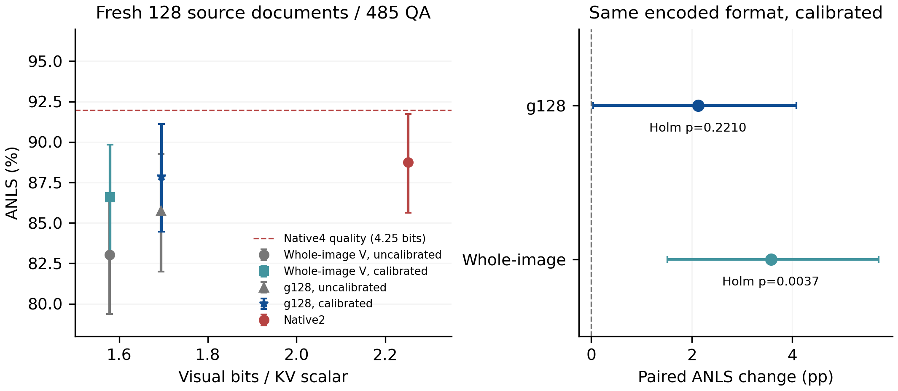
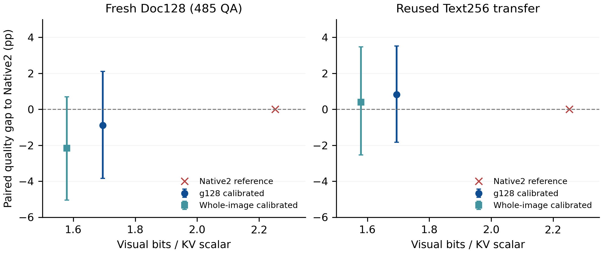
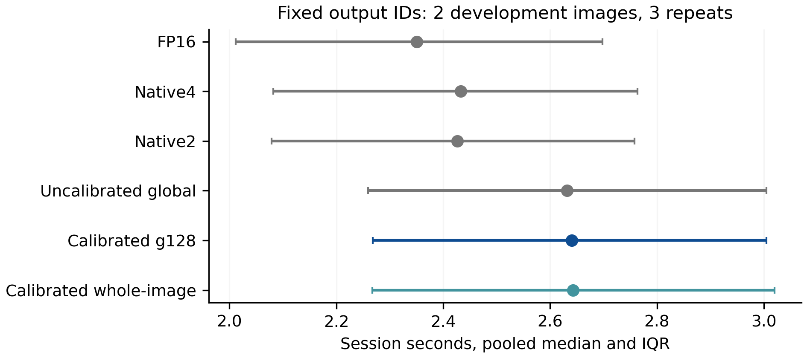

# 本轮探索结果与下一步方案

本轮完整探索已经收尾。最有价值的推进是：**用少量功能参数校准，在保持真实packed格式和基础模型权重不变的情况下，追回整图元数据压缩造成的明显损伤，形成约1.695和1.579bit两个可运行资源点。** 当前结果支持继续研究条件化精度分配；固定Native4的0.5pp质量目标仍未达到。

## 1. 最终独立确认与转移结果

开发阶段12个400步无标签拟合，比较K中心化/整体增益、V增益/中心、每128token/整图V分组以及两种校准上下文。19方法×64图共1216自由会话完成；320组历史控制和64组实现identity的首logits、完整回答、owner字节完全一致。

据完整开发结果选定主方案`cold_meta_g128_kv`，次要低元数据方案`cold_meta_all_kv`，在另外128份新源文档485问上做一次确认。8配置、1024自由会话、3880条答案全部完成；输入、方法与参数在新数据结果前固定。

| 方法 | Doc视觉bit/scalar | 新Doc128 ANLS | Doc exact | Text256 soft acc |
|---|---:|---:|---:|---:|
| Full | 16.002 | 91.73 | 83.51% | 81.21% |
| Native4 | 4.252 | 91.97 | 83.71% | 81.99% |
| Base2 | 2.252 | 88.76 | 77.73% | 80.63% |
| 主方案，g128功能校准 | **1.695** | **87.87** | **78.97%** | **81.45%** |
| 次要方案，整图分组功能校准 | **1.579** | **86.60** | **79.18%** | **81.02%** |
| 未校准g128方向码 | 1.695 | 85.75 | 76.70% | 80.12% |
| 未校准整图分组 | 1.579 | 83.02 | 71.75% | 本轮未追加 |
| 上轮学习K大书的warm联合 | 1.731 | 87.01 | 78.14% | 81.13% |

Text256是此前已经评估过的128数字+128文字平衡子集，两个新候选共512回答。候选仅按Doc开发选择；该列是转移复用，不称作新的盲图确认。bit/scalar随图像token数略变，Text两候选实际约1.6950、1.5795。

主方案相对Base2视觉存储少24.75%，ANLS低0.89pp，配对95%区间[−3.84,2.10]pp；Text点分高0.82pp，区间[−1.84,3.52]pp。不能把这些区间当作等质量证明。

次要方案相对Base2视觉存储少29.90%，Doc ANLS低2.16pp，Text点分高0.39pp，形成更激进的资源点。ANLS下降而exact略高，说明两指标反映的错误结构不同；主指标仍按预先规定的ANLS报告。

## 2. 本轮真正得到确认的收益

**整图分组上的功能校准，由83.02提升到86.60 ANLS，+3.57pp，95%配对区间[1.51,5.71]pp，六个计划对比Holm p=0.00372。** packed码字与decoder缓存格式保持相同，1344B encoder因子折叠原有F16行增益/均值与V scale/minimum，已计入预算资格。基础8B模型不更新，无在线参考分支。

g128校准相对自身未校准版本高2.12pp，区间[0.04,4.08]pp，但Holm p=0.221，未通过本轮主要比较家族。新低维方案比学习K大书的旧联合方案点分高0.86pp、价格少2.08%，差别区间跨0；它是较简洁的新候选，不是已证实全面胜出。

元数据压缩本身有质量代价：同样未校准时，g128为85.75，整图为83.02。后续校准追回了相当部分损伤。因此“元数据应该先无损省掉”不是成立的前提；分组、重建目标和整个模型使用方式要一起检验。

## 3. 机制上更清楚的部分

前一轮16图探针显示，V-only与global的K重建及固定Full-query下的K-score完全相同，后续层query却不同。V可通过隐藏状态影响后续读取，而不只影响当层加权输出。

本轮K中心化增益与整体增益分别拟合。数学上，正的统一增益在固定query下保留同一KV-head的视觉内部排序，但会改变softmax权重及视觉/文本段的相对质量；端到端后续query也会变化。开发中两种增益位置有不同效果，当前不将其推成普适最优规则。

旧的一比特范数×方向oracle仍说明方向信息重要；新的函数校准说明，在已有可用几何后，重建误差的条件化作用仍值得修。二者不矛盾，也不能转成单个“K比V贵多少倍”的常数。

## 4. 成本、运行和环境修复

小规模固定输出计时共2图×6方法×3测量=36测量+12预热，每问题完全相同8个输出ID：

| 配置 | 会话中位秒数 |
|---|---:|
| Full | 2.351 |
| Native4 | 2.433 |
| Base2 | 2.426 |
| 未校准global方向码 | 2.632 |
| 主方案 | 2.641 |
| 整图分组方案 | 2.643 |

主方案比Base2慢约8.84%。校准相对同一global底座的额外耗时较小，但当前没有加速结论。两图计时仅作描述，不是吞吐评测；全部主质量结论来自自然自由生成。

确认初次执行遇到系统盘Triton缓存空间耗尽，保留61/71条完整会话和错误记录。缓存/TMP/TorchInductor/CUDA目录改到项目数据盘后，原方法、输入、参数和源码不变，完整重跑成功；132条已有会话的首logits、完整token与owner字节全部一致。新的`launch_remote_data_disk.py`默认使用数据盘缓存，原冻结启动器保持字节不变。

1024确认和512转移记录的来源、参数与独立owner公式均PASS。正式旧包1287/1331/974文件继续保留。所有模型均在双3090上完整运行，原图/模型/结果位于数据盘，CPU只做调度与统计。

## 5. 下一步值得投入什么

目前不继续扩展触发器或进行4万次完整大基准。按本轮结果，下一步优先检验以下三个相互关联的问题：

1. **用省出的比特补真实内容误差。** 约1.58bit底座距1.8还有约0.22bit空间，做等字节K残差/V残差和均匀控制，判断边际收益在哪。层×KV-head索引便宜，残差本体必须完整计费。
2. **分开偏置与方向损伤。** 检查压缩后重建均值偏移、视觉/文本段的相对偏置，尝试少量更高精度均值或重建偏置校正。固定query的视觉排序和整模型答案不是同一目标。该方案尚未实现，没有结果。
3. **更好的精度对照。** 16图62问的固定K2诊断中，V1为92.14、V2 RTN为92.40、V16为95.42，Full91.02。V2与V1使用不同重建规则且样本很小，不据此宣判加V位宽无用，也不把V16当数学准确率上界。后续使用一致优化目标的残差剂量和实际任务收益。

目标仍是接近强质量参考，而非只降低byte数字。当前主方案对Native4低4.11pp，0.5pp点目标和区间非劣均未达到。下一轮先在现有开发上快速设计，冻结最有希望的少数方法后再做一次足量确认；完整5000问基准等方法定型后，用必要的强对照运行。

从最初路线至今的全部进展、负结果与来源见[项目时间线](PROJECT_HISTORY_2026-11-14.zh.md)。本轮源码、参数、统计、科学图与派生证据将分批公开到GitHub，原图/权重从上游获得。
