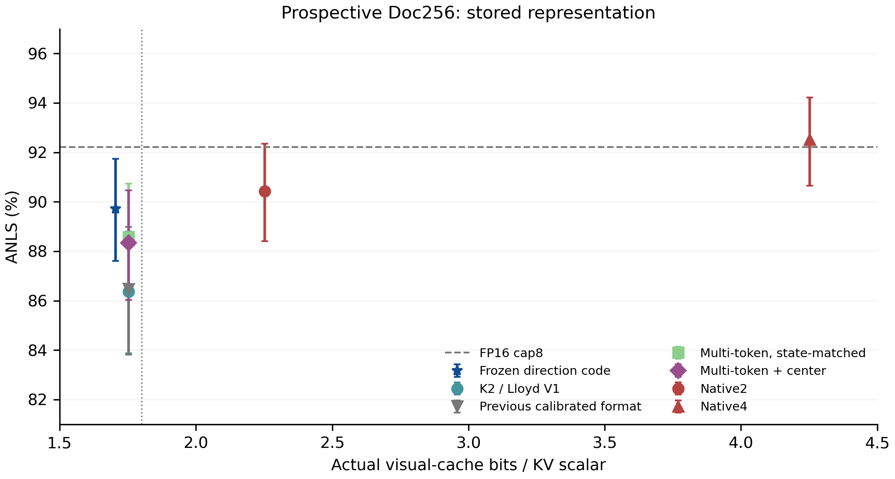
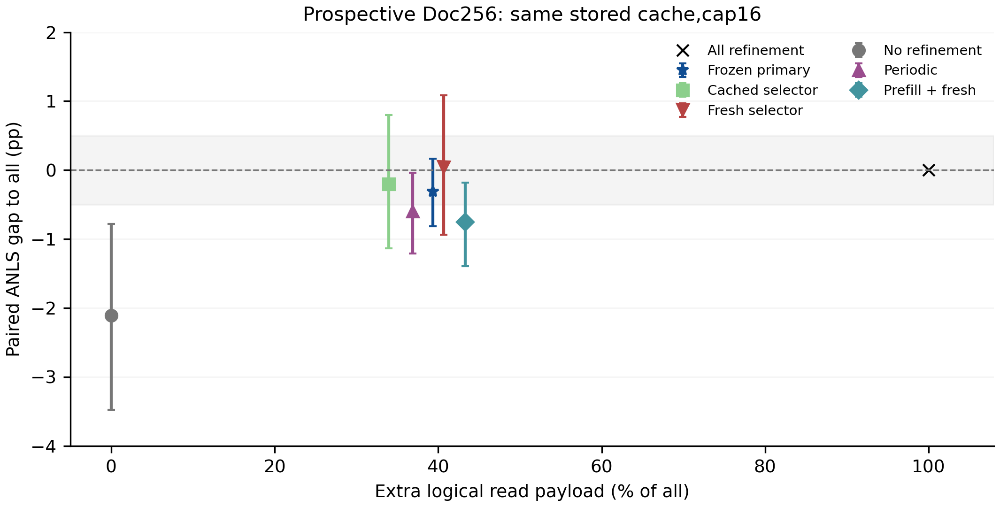
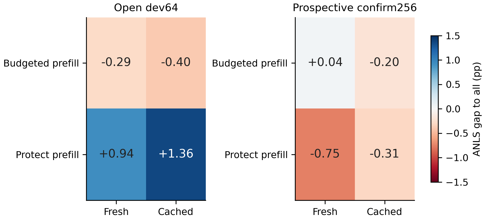
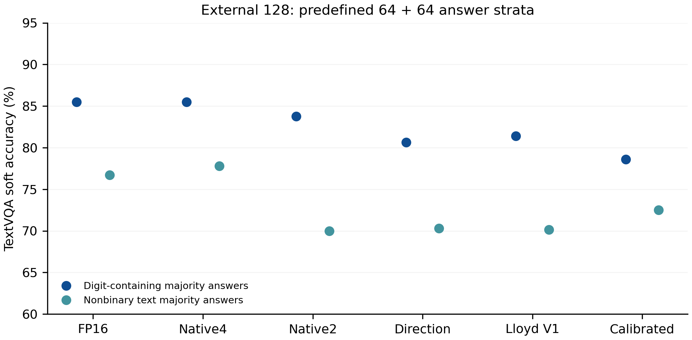
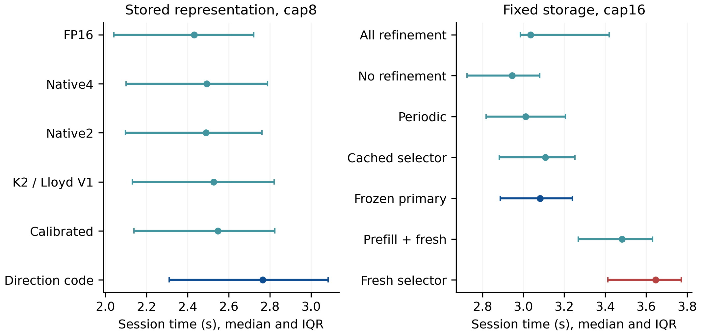

# 新256文档确认与外部128图结果

本轮完整确认给出的结论是：**方向表示相对同档标量方案的收益得到复制；预算化读取达到预设点目标；prefill保护的额外优势没有复制。** 低于1.8bit时距强质量参考0.5pp的存储目标仍未达到。后续继续改重建表示，读取结论按实际预算与工作负载报告。

全部结果来自完整 InternVL3-8B-hf 的真实GPU自由生成。模型统一FP16、28层、4个KV heads、D128；所有部署候选实际读取packed视觉KV，文本KV保留FP16。模型、输入、编码参数和方法在确认结果前冻结。

## 1. 完整性与独立核验

256份源文档、999问、23配置、5888次自由会话全部完成，共22,977条计分答案。新外部TextVQA128的13配置也全部完成，共1664回答。源文档与cal32/dev64、已核对的legacy1000所涉及源文档分离。

Doc256独立核验PASS：58项冻结推理来源检查、16项外部编码参数检查、5632项独立tensor owner公式。外部128来源检查58项PASS。统计重采样整份源文档；10个事先冻结的主要对比作Holm校正。

## 2. 存储：表示收益复制了，强质量目标未达

同cap8输入：

| 方法 | 视觉bit/KV scalar | ANLS |
|---|---:|---:|
| FP16 | 16.002 | 92.21 |
| Native4，冻结强参考 | 4.252 | 92.51 |
| Base2 | 2.252 | 90.44 |
| 冻结方向码主候选 | **1.705** | **89.72** |
| 新cold多token gain | 1.752 | 88.58 |
| 新warm多token gain | 1.752 | 88.11 |
| 新cold多token+center | 1.752 | 88.34 |
| K2/Lloyd V1 | 1.752 | 86.37 |
| 上轮校准主候选 | 1.752 | 86.48 |

方向码比K2/Lloyd V1高3.35pp，95%配对区间[1.43,5.50]pp，Holm校正p=0.0058；比上轮主候选高3.25pp，校正p=0.0082。这个相对收益在更大新样本上成立。

相对冻结Native4参考，方向码低2.79pp，区间[−4.29,−1.30]pp，未达到0.5pp目标。相对Base2，视觉存储少24.30%，ANLS低0.71pp，次要比较区间[−2.25,0.81]pp；不能把跨0当作等质量。

存储价格包含索引、元数据、行增益、均值、位置和所需共享常量；encoder-only校准参数在预算资格中另作保守计费。这里是视觉KV价格，不是整个模型峰值或全部KV的压缩比。KVarN数值质量端口实际持有重构与packed参考，未画成低bit部署点。

## 3. 读取：点目标通过，区间仍有边界

所有读取策略在每份图像上持有完全相同的约4.0679bit视觉表示。主候选是开发阶段选定的“优先精化问题prefill，再复用问题内mask”，0.5表示包含选择成本的字节预算档。

| 策略 | ANLS | 比all的差值 | 额外逻辑读量节省 |
|---|---:|---:|---:|
| all | 93.61 | 0 | 0 |
| 冻结主读取候选 | **93.30** | **−0.31pp** | **60.62%** |
| 缓存mask，不额外保护prefill | 93.41 | −0.20pp | 66.04% |
| 每步fresh risk | 93.66 | +0.04pp | 59.34% |
| 周期策略 | 93.01 | −0.60pp | 63.09% |
| prefill + fresh | 92.86 | −0.75pp | 56.67% |
| none | 91.50 | −2.11pp | 100% |

主候选满足“额外逻辑读少至少50%，ANLS不低于all超过0.5pp”的预设**点目标**；总逻辑KV读量少23.21%。其配对95%区间为[−0.82,0.17]pp，还不足以证明0.5pp非劣。

相对none，主候选高1.80pp，配对区间[0.47,3.16]pp；10对比Holm校正p=0.0786，没有通过主要家族0.05显著性判据。none相对all的2.11pp缺口说明，开发集上两者近似同分的现象并未泛化。

不额外保护prefill的cached次要配置，点分数略高且读得更少。它不替换冻结主候选。两个prefill保护效应在本确认中没有复制，因此后续不把prefill全精化当作必然优势，保留选择复用和预算分配的条件化解释。

## 4. 强对照和输入设置

cap16下，Full为93.60、Native4为93.98、Base2为91.50。读取主候选相对Native4低0.68pp，次要配对区间[−1.65,0.20]pp；其视觉存储少4.33%、总逻辑KV读量少28.27%。这个对照不能写成满足对Native4的0.5pp点容差。

cap8 Native4为92.51，cap16 Native4为93.98。较高输入分辨率在这批新确认上有收益，与开发集的均值排序不同。跨cap应同时比较输入、实际总字节、质量与时间，不能只按bit/scalar排序。

逻辑读量是调用级payload及已声明的选择费用，不是物理HBM交易。自由输出长度有差别，因此时间结论使用下方同输出计时。

## 5. 外部：文档收益没有变成普遍优势

新TextVQA128按主答案含数字/非二值文字各64图固定选择，采用官方十标注soft accuracy，不是ANLS，也不是官方整体分布估计。

| 方法 | 总体 | 含数字64 | 文字64 |
|---|---:|---:|---:|
| Full | 81.09 | 85.47 | 76.72 |
| Native4 | 81.64 | 85.47 | 77.81 |
| Base2 | 76.88 | 83.75 | 70.00 |
| 方向码主候选 | 75.47 | 80.63 | 70.31 |
| K2/Lloyd V1 | 75.78 | 81.41 | 70.16 |
| cold多token gain | 75.55 | 78.59 | 72.50 |
| warm多token gain | 75.55 | 78.59 | 72.50 |

方向码相对Full低5.63pp，配对区间[−10.94,−0.55]pp；相对Lloyd为−0.31pp，区间[−3.75,2.73]pp。它在Doc256相对Lloyd的优势没有转为通用外部优势。cold/warm多token聚合分数相同也不证明两个量化器或轨迹完全相同。

这些是K/V联合干预，数字/文字分层不能单独推出V的比特底线。后续对跨域外推和V-only机制保持独立验证。

## 6. 同输出计时：少读尚未转为会话加速

6张开发图、16配置、每配置3次测量，共288次测量和96次预热全部完成。每个问题使用完全相同的8个强制输出ID；同cap的逻辑位置、对话结束标记一致。每次测量边界均核对两张卡无其他计算进程。模型加载不计时，输入准备、因果前缀提取、编码、问题重放与生成均计入会话时间。

| 配置 | cap | 会话中位秒数 | 四分位区间 | token间隔中位ms |
|---|---:|---:|---:|---:|
| Full | 8 | 2.432 | [2.042,2.722] | 37.34 |
| Base2 | 8 | 2.490 | [2.097,2.762] | 37.88 |
| K2/Lloyd V1 | 8 | 2.527 | [2.131,2.820] | 38.35 |
| 冻结方向码 | 8 | 2.765 | [2.311,3.083] | 42.06 |
| all | 16 | 3.036 | [2.985,3.419] | 46.32 |
| 冻结读取主候选 | 16 | 3.082 | [2.887,3.240] | 40.80 |
| 缓存mask | 16 | 3.107 | [2.883,3.252] | 41.22 |
| 每步fresh risk | 16 | 3.646 | [3.413,3.771] | 54.75 |
| 周期策略 | 16 | 3.011 | [2.818,3.206] | 41.47 |

主读取方案比all的会话中位数高约1.53%，不能宣称端到端加速。其token间隔更低，但输入预处理和编码等共同成本使会话总时间不同。cached相对fresh的耗时下降说明选择成本值得摊销；这是六张开发图上的描述性计时，不是吞吐或多租户服务结论。方向码当前比Base2慢约11.07%，其质量/字节收益同时伴随运行时间代价。

计时审计PASS：288次测量、96次预热、29项冻结推理来源、2项外部编码文件，方法配置与确认质量实验完全一致。误差线为测量四分位区间，不是质量置信区间。完整模型峰值约16–17GB，模型权重和原生前缀生成占主要空间，不能把视觉缓存压缩率写成模型峰值的同等下降。

## 7. 接下来沿结果继续

共享方向重建表仍是下一支表示实验。它直接增加重建自由度，基础模型冻结，不借助在线参考分支；Gaussian编码索引保留，decoder书及可选V元数据通过真实packed forward校准。GPU算子9+3检查和完整模型4输入2步梯度小测已经通过；目前没有新图质量结论。

隔离计时已完成，双3090正在执行正式码本校准，之后接11方法开发评测。新方法不会追加到已看过的Doc256确认；另128份未用源文档、501问已预先冻结并传输校验，用作之后独立确认。

旧阶段报告与冻结资产继续保留。当前完整记录在`results/next_confirm256_analysis`、`results/next_textbalanced128_analysis`、`results/next_confirm_timing`，独立核验为`audit/a2/NEXT_CONFIRM256_AUDIT.json`与`NEXT_TEXTBALANCED128_AUDIT.json`。本文件只报告完整结果，之后的码本研究单独记录。
