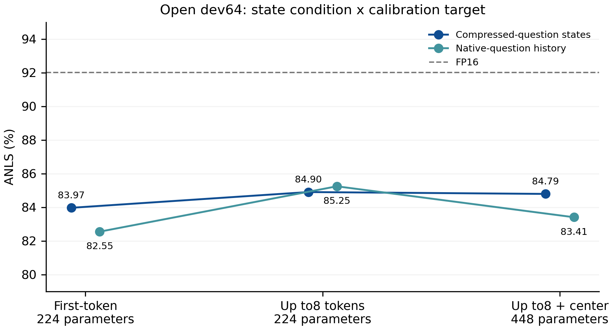
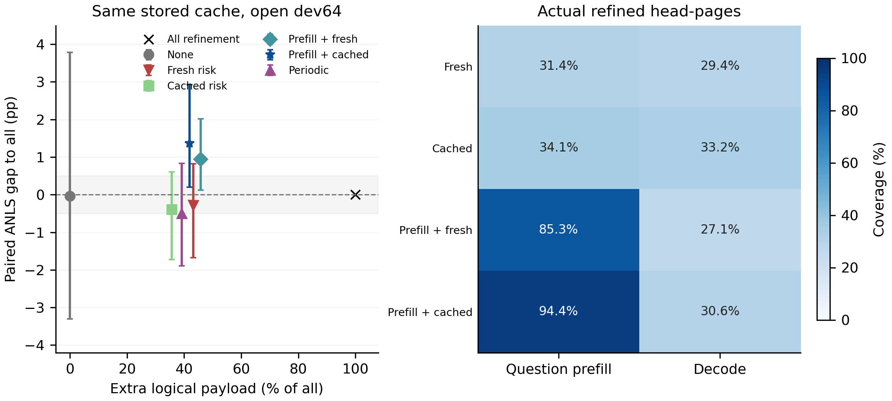
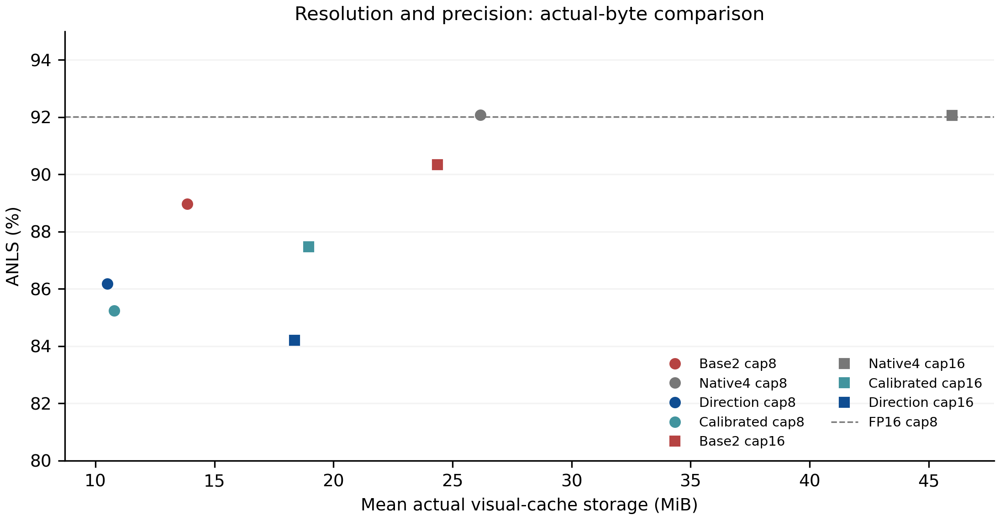

# 新源文档开发：从低比特表示到问题状态精度

本轮完成了同一批64份新源文档、255问上的多条开发实验。它们把下一步收紧为两件事：**存储侧直接增加方向重建自由度；读取侧优先保护问题状态形成，并摊销选择成本。** 当前23配置的256份新源文档确认和外部128图已经冻结、正在运行，本文不使用它们的部分分数。

所有自由生成及校准均使用完整 InternVL3-8B-hf，在自有双RTX3090上运行。Windows只调度、计分、绘图。校准采用32份其他源文档、83个独立问题输入，不使用标准答案，预训练模型权重冻结。

## 1. 更多校准位置有帮助，增加中心参数没有继续突破

| 校准 | 压缩问题状态 | 原生问题历史 |
|---|---:|---:|
| 首答案token，224参数 | 83.97 | 82.55 |
| 最多8个答案token，224参数 | 84.90 | 85.25 |
| 最多8个token，加center，448参数 | 84.79 | 83.41 |

同批数据上的 Full 为92.00，原生4-bit为92.08，Base2为88.97，K2/Lloyd V1为82.48，方向码为86.18。当前≤1.8bit方案尚未达到距强参考0.5pp的目标。

旧20图/RMS初始化设置中，状态匹配校准在确认64和外部128分别比原生历史校准高6.73和7.42pp。本轮更换为32源文档、identity初始化和更多目标位置后，差距明显缩小。应该把“状态条件的重要性”按具体量化器和校准配置报告。当前证据不支持把“总能提高7pp”写成普遍规律。

## 2. 问题prefill保护与选择复用值得独立确认

所有读取策略持有相同的约4.0679bit视觉表示，包括完整base、残差、选择统计、GPU页掩码及CPU控制状态。非all策略的总预算均为16次全残差前向等价字节，选择费用也计入。

| 策略，0.5预算档 | ANLS | 相对all额外逻辑读量节省 |
|---|---:|---:|
| 每步fresh risk | 90.09 | 56.82% |
| 问题内复用mask | 89.98 | 64.40% |
| 优先精化prefill + fresh risk | 91.31 | 54.19% |
| 优先精化prefill + 复用mask | **91.74** | **58.05%** |
| all | 90.37 | 0 |
| none | 90.34 | 100% |

最后一项组合比all高1.36pp，探索性配对95%区间[0.20,2.93]pp，总逻辑KV读量少21.77%。这是开发结果；none与all也近似同分，因此下一确认保留none、all、每步重选、周期策略和原生4-bit，检验实际收益。

**0.5是字节预算档，不代表选中50%的页。** 扣除选择费用且受全局预算限制后，组合策略实际覆盖94.4%的prefill head-pages、30.6%的decode head-pages。prefill+fresh则为85.3%和27.1%。选择复用同时影响计算开销和后续可用精度：少付选择费用，会留下更多预算处理后来问题。

两个保护prefill的策略，在64/64文档上首问题logits哈希相同。这提供了明确对照：首问状态一致，后续的页选择与预算演化不同。尚不能仅凭开发均值将所有质量差别归给某一个环节。

以上是调用级逻辑payload和预先声明的选择费用。物理HBM流量没有有效计数器，速度由独立同输出计时验证。上一轮risk已经出现“少读但更慢”，不能直接把字节比当加速比。

## 3. 少量通用观察状态没有提供主要修复

我们测试了在实际问题到来前，先形成少量固定prefix状态，再保存为专门的compact FP16 KV。所有新增token都在这些被计费的状态中；native前向不含实际问题。native与compressed状态形成臂使用相同token串、相同存储。

在1792视觉token的文档上，仿射编码允许5个状态，保守计费1.7970bit；方向编码允许10个状态，计费1.7940bit。全部576次会话的独立存储公式和输入对照核验通过。

| 编码 | 原始输入 | native观察状态 | compressed观察状态 |
|---|---:|---:|---:|
| 仿射编码 | 85.34 | 82.89 | 83.45 |
| 方向编码 | 86.23 | 87.03 | 86.91 |

方向编码native比同token低精度形成对照只多0.12pp，配对区间[0,0.32]pp，未支持主要精度收益。仿射支线下降。固定prefix也改变了Full表现，因此本轮保留匹配Full对照，没有把缩小参考差距全部当作恢复。

这个结果把投入方向推向**已知真实问题时的精度分配**，而不是继续假定几个通用状态能保存所有视觉事实。

原型v1曾留下未独立计费的长提示历史，已停止且不计分；v2修正输入后遇到变长临时stride造成重复编译，v3固定stride后完成。取消记录与原代码保留，完整结果只来自v3。

## 4. 增加图像token不是免费解决办法

| 输入 | Full | Native4 | Base2 | 校准K2/V1 | 方向码 |
|---|---:|---:|---:|---:|---:|
| cap8 | 92.00 | 92.08 | 88.97 | 85.25 | 86.18 |
| cap16 | 91.26 | 92.07 | 90.34 | 87.47 | 84.20 |

校准方案在cap16涨2.22pp，但总缓存也增加；其字节/质量点还被cap8 Base2支配。方向码在更大输入下反而下降。对跨输入设置的比较，应同时展示实际总字节、视觉token数量和匹配参考，不把较低bit/scalar误当较低总存储。

cap16 Base2与读取none在64/64文档上，完整生成token串及首logits哈希一致。这也说明，保留残差却不读取的none主要用于同存储机制对照；实际部署还必须比较不保存残差的Base2。

## 5. 正在执行和随后执行

当前冻结契约为`audit/a2/next_confirmation_v1.json`。256份新源文档有999问、23配置、5888次会话；外部新TextVQA128有13配置、1664回答，按主答案含数字/非二值文字各64图固定抽取。外部子集不代表官方整体分布。方法、参考、10个计划对比、0.5pp容差和读取目标均已在结果前锁定。

全部质量评测完成后，会在两卡无其他模型时做同输出计时：6份旧文档、16方法、96次warmup、288次测量，每实际问题同8个输出ID。随后才启动下一表示实验，避免与计时争用GPU。

下一表示原型是**共享方向重建表的行为校准**。用不保存矩阵的FWHT实现旋转，将原65,536字节常量空间部分换给每层/KV-head的F16重建表。112个256×4表共229,376字节，固定Gaussian encoder另2KB；与原方案相比净多163,840字节，在当前开发token量上预计约多0.025bit，仍需实际owner验证。小图若超过1.8bit预算则使用compact全局表，分支由图像长度确定。

底层GPU检查已通过：9组reader、3组旋转；FWHT与独立Torch蝶形实现的最大误差为0，与显式矩阵最大误差约2.03e−6，读取最大误差0.000488，重复相同码本的输出一致。完整模型梯度检查和校准尚未运行。计划比较原生历史/压缩状态，以及是否同时校准V的已有元数据；基础模型权重冻结。新方法只用cal32/dev64选取，另预留的128份未用源文档、501问用于之后确认，不能将已运行的256份文档重新标成新方法的盲确认。

## 6. 结果入口

开发原始记录与汇总分别在`results/trajectory_development64_analysis`、`results/cached_reads_factorial64_analysis`、`results/anchors_development64_analysis`、`results/density_development64_analysis`。独立端点、输入和字节核验在`results/development_mechanism_audit`。

之前完成的确认周期仍保留在`docs/RESEARCH_DISCOVERIES_2026-11-14.zh.md`和`audit/a2/COMPLETED_CONFIRMATION_PACKAGE.json`：1331个文件未改动，旧第一周期1287文件也保持原hash。
