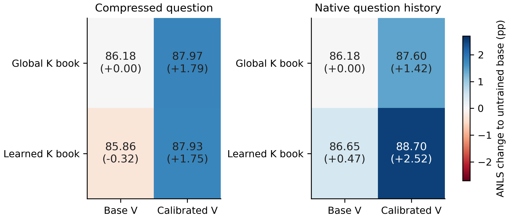
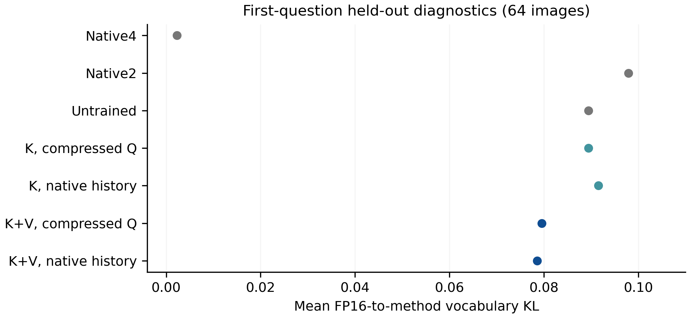
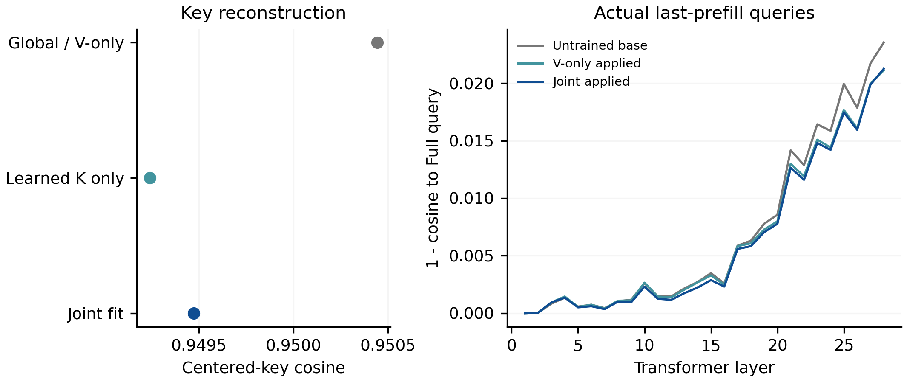

# 方向表示之后，K/V 修正的价值发生了变化

这一轮开发最有用的发现是：**K-only 校准的最终训练KL很小，但独立输入和自由回答没有明显改善；联合修正 V 元数据后，两类开发指标才改善。** 同一份联合拟合的四臂进一步表明，不能把联合收益全记在 K 码本名下。这是现有开发数据的发现，新源文档确认仍在执行。

## 完整执行与方法

4个正式拟合各400步：压缩问题上下文/原生问题历史 × 仅K书/联合V元数据。32份无标签校准源文档、83问题输入，Full自生最多8token作为分布目标；基础8B模型权重冻结。采用实际packed前向与直通梯度，完整模型梯度检查、9个reader与3个rotation算子检查均通过。

开发共1152次真实GPU自由会话：15个唯一方法×64图=960会话，另外192次重复控制。192组的首logits、完整token轨迹、tensor owner字节全部一致。另704条参考答案强制上下文诊断，以及16图×7方法×28层=3136条几何仪器记录，后两者均不计入任务准确率。

## K/V 四臂

同一份联合拟合，运行时分别启用 K 表、V 元数据，未重新训练：

| 应用 | 压缩问题上下文拟合 | 原生问题历史拟合 | bit/scalar，含encoder常量 |
|---|---:|---:|---:|
| 都不应用，global方向码 | 86.18 | 86.18 | 1.6945 |
| 只应用K | 85.86 | 86.65 | 1.7300 |
| 只应用V | 87.97 | 87.60 | 1.6946 |
| K和V都应用 | 87.93 | **88.70** | 1.7302 |

Full92.00、Native4 92.08、Base2 88.97、K2/Lloyd V1 82.48。所有数字是64源图、255问的ANLS百分数。

warm联合相对global高2.52pp，配对95%区间[1.06,4.23]pp；相对自身K-only高2.05pp，[0.81,3.53]pp。cold联合与其V-only几乎同分，点差−0.04pp；warm联合比其V-only高1.10pp，[0.11,2.38]pp，但置换检验和多重比较不足以确认这项独立K收益。交互项区间均跨0：cold+0.28pp、warm+0.63pp，不称作已证实的协同规律。

V-only不保留学习的逐层/头重建表，约省0.0356bit/scalar。896B V校准参数在encoder侧另计，已折叠进原有F16元数据，无额外在线参考分支。联合方法保留229376B F16重建表；小图若会超过预算，按已声明的N规则回退compact书。

## 训练改善与独立输入的行为改善不同

校准集最终KL约0.0075–0.0096。该目标使用Full自生上下文，不能直接和下面参考答案上下文的KL作比率。

在64张开发图的首问题、规范第一参考答案上下文上：

| 方法 | FP16→方法的词表KL |
|---|---:|
| Native4 | 0.00227 |
| Base2 | 0.09788 |
| global方向码 | 0.08941 |
| 仅K，压缩问题校准 | 0.08943 |
| 仅K，原生历史校准 | 0.09154 |
| 联合，压缩问题校准 | 0.07951 |
| 联合，原生历史校准 | 0.07860 |

因此，当前训练集上的成功没有转化成K-only的独立输入改善。不能据此宣判学习K表一般无效：校准规模和参数化仍是条件；但本轮收益应主要围绕实际复制的联合/V修正讨论。

## 几何与状态的区别

固定16开发输入，采集真实packed模型在首问题最后prefill位置的query。global的去均值K方向余弦约0.95044，warm K-only为0.94924，联合为0.94947；本轮学习没有改善这个平均几何指标。

V-only与global的K重建、固定Full-query下的K-score诊断，在全部448个图像×层位置上完全相同。它们的后续层query仍然不同，且V-only的平均query-to-Full余弦为0.99362，global为0.99309。它直接展示了：**V改变隐藏状态，再改变后续层query；单层“V只进入加权和”不能推广为全模型“V只局部影响”。** 这项探针不证明跨轮误差累计。

仪器额外保留FP16源K，仅用于诊断。原始score RMSE未去公共平移，不能用其分量大小宣称“状态贡献占多少”或softmax被破坏多少；这里采用固定K相等检查与query几何解释，不作能量占比归因。

## 已进入的下一轮

依据完整开发结果、在新结果前选定warm联合为主候选，保持Native4和0.5pp参照，当前开发存储质量目标未达。新Doc128/501问与新Text256的18配置已经在双3090运行；之后接同输出隔离计时和完整TextVQA5000问、8方法基准。所有新确认与基准方法已冻结，当前不读部分分数。

另有16图的固定K2、V1/V2/V16自由回答剂量诊断，放在新确认完成之后、计时之前。它只指引后续研究；V2/V16不作为低于1.8bit的部署方法。

执行与资源目标见[当前目标](GOAL_2026-11-14_v5_FUNCTIONAL_RECONSTRUCTION.md)。完整统计位于`results/book_factorial64_analysis/factorial_summary.json`，用于方法选择的原`summary.json`按冻结hash保留；连续与几何分别在`book_continuous64_analysis`、`book_geometry16_analysis`。
